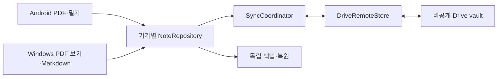

# Android·Windows·Drive MVP 설계

2026-10-22. 사용자가 세 분석 결과의 반영과 Android·Windows·Drive MVP 개발 시작을 승인했다. Saber 기반 검증판을 구현 중이며 실기기·실제 Drive 인증 결과와 코드 시험을 구분한다. 진행 결과는 [개발 계획](roadmap.md)과 [작업 기록](../_docs/history/2026-10-22.md)에 남긴다.

## 세 앱 분석을 반영한 결정

- **Saber:** 고정 커밋의 펜·PDF·BSON 편집기를 재사용한다. 기존 경로 식별·Nextcloud 시각 비교 동기화 대신 UUID, 완전한 불변 리비전, 내용 해시 첨부를 붙인다. 원본 PDF 자산은 보존하며 획 수정마다 전체 백업을 올리지 않는다. GPL과 원 저작자 고지는 유지한다.
- **StarNote:** 공식 기능 설명의 PDF 위 필기와 도구 접근성을 참고하되, Manifest/리소스 조사만으로 저장 형식이나 Drive 구현을 추정하지 않는다. 레이어·올가미·AI·녹음·전용 형식 가져오기를 첫 범위에 추가하지 않는다.
- **Obsidian:** Markdown 원문을 canonical 데이터로 두고 검색·페이지 연결 인덱스는 재구축 가능한 파생 데이터로 둔다. 제목/경로 변경과 독립적인 UUID 링크를 쓴다. 일반 역링크·그래프는 파생 인덱스를 확장할 후속 작업이며 배포물 코드는 재사용하지 않는다.

첫 구현의 선택은 Flutter/Dart 공통 앱, Saber 전체 기반, 별도 순수 Dart 저장·Drive 패키지다. 원본 편집기와 저장/전송 경계를 분리해 교체 비용을 낮춘다. 이는 제품 채택 판정이나 S9+ 필기 품질 검증을 대신하지 않는다.

## 목적과 범위

**사용자 확정:** Galaxy Tab S9+에서 PDF에 필기하고 Windows에서 그 필기를 보며 Markdown으로 정리한다. 수동 이동 대신 Drive 자동 동기화를 첫 MVP에 포함한다. Saber 재사용 검토를 먼저 하고 결과로 설계/계획을 정리한다.

목적 위계는 개인 필기·지식 연결 → 태블릿에서 PC로 이어 쓰기 → 필기/저장/동기화/복구 검증이다. 본인 한 명이 사용한다. 성공은 수동 이동·새로고침 없이 자료 손실 없이 이어 쓰는 것이다.

**작성자 권고:** Flutter/Dart 공통 앱과 Saber 고정 커밋 전체 기반의 제한된 검증판. [조사 결과](saber-reuse-review.md)의 gate를 통과한 뒤 제품 기반 채택을 결정한다. 일부 editor 추출은 후순위, 독립 Flutter는 검증 실패 시 대안이다.

- Android: PDF 가져오기, 펜·형광펜·획 지우개, undo/redo, 확대·이동, 자동 로컬 저장, Windows Markdown 열람.
- Windows: PDF+필기 보기와 Markdown 원문/수식 편집·미리보기의 분할 화면.
- 공통: 고정 ID·문서/페이지 링크·제목/Markdown 본문 검색, 오프라인 재열기, 자동 동기화 상태·충돌 선택·삭제 복구, 백업/빈 저장소 복원.
- **제안한 역할 제한:** 첫 UI는 Android 필기 편집, Windows Markdown 편집에 집중한다. 두 기기는 PDF·필기·Markdown을 모두 수신/보관한다.
- 태그·일반 노트 역링크·그래프·AI·OCR·StarNote 가져오기·iOS·실시간 공동 편집은 후속 제안이다. 기존 PDF annotation 개별 편집과 원본 텍스트/링크 보존형 PDF 출력도 후속이다. 원본 PDF 자체는 보존한다.

## 구성

`SaberInkAdapter`는 native 본문/첨부를 완전 snapshot으로 캡처·재열기한다. `NoteRepository`는 ID·리비전·로컬 발행·복구를 맡는다. `DriveAuth`는 Android 네이티브 authorization과 Windows 시스템 브라우저 OAuth/PKCE·loopback을 각각 처리한다. `DriveRemoteStore`는 전송/변경 feed를, `SyncCoordinator`는 지속 큐·재시도·충돌·상태를 맡는다. 첫 MVP는 별도 상주 서버 없이 각 앱이 Drive API에 직접 연결한다.

## 저장 계약 — 작성자 제안

1. vaultId/noteId/pageId/markdownId/deviceId는 생성 시 UUID로 고정한다. 제목·경로·시각을 식별자로 쓰지 않는다. Saber 페이지 생성/직렬화에도 pageId를 넣어 재배치 뒤 유지한다.
2. 원본 PDF는 바이트와 SHA-256을 보존한다. 기존 문서 PDF 교체 UI는 첫 범위가 아니며 새 PDF는 새 noteId로 가져온다.
3. metadata, 한 노트의 ink snapshot, 각 Markdown 원문은 별도 동기화 객체다. ink snapshot은 BSON 본문과 논리 asset 경로→해시/길이 목록이다. 페이지/획 단위 병합은 하지 않는다.
4. `RevisionRecord` 필드는 vaultId, entityId, kind(metadata/ink/markdown), revisionId, parentRevisionIds, deviceId, formatVersion, deleted, blob 참조·길이·해시다. 자식은 ownerNoteId를, 노트 삭제/복원은 자식 head 목록인 baseRefs를 함께 저장한다. 수정 시각을 승자 판단에 쓰지 않는다.
5. 편집기 작업본과 확정 리비전을 분리한다. 같은 문서의 저장/snapshot 캡처를 직렬화하고 본문·첨부를 검증한 뒤 불변 완료 manifest를 원자적으로 발행한다. head는 ancestry에서 계산하며 공유 head 포인터를 덮어쓰지 않는다. 실패 시 이전 완전 세대로 연다.
6. 첨부는 해시로 중복 제거한다. PDF 최초 전송 후 획 수정에는 변경된 본문/첨부만 보낸다. `.sba` 전체 반복 업로드는 일상 동기화로 쓰지 않는다.
7. 첫 구현은 불변 파일 manifest/blob을 canonical 데이터로 쓰고 인덱스는 열 때 메모리에 재구축한다. 전송 상태는 별도 로컬 파일에 지속한다. SQLite 도입은 데이터량 실측 뒤 결정한다. 초기 의존성을 줄이는 선택이며 큰 vault에서 시작 시간이 늘면 SQLite 캐시를 추가한다. 캐시나 전송 상태 파일 자체를 동기화하지 않는다.

## 자동 동기화 계약 — 작성자 제안

- 같은 계정·같은 Google Cloud 프로젝트의 플랫폼별 OAuth client로 한 vault를 연결한다. Android가 처음 만든 앱 전용 일반 Drive 폴더를 Windows가 연결하는 경로부터 확인한다. `drive.file`을 우선 검토하되 실제 두 client의 접근을 검증한다. 숨김 appDataFolder는 첫 안으로 쓰지 않는다.
- blob을 먼저 전송하고 검증된 참조를 담은 **불변 리비전 manifest를 마지막에 새 파일로 발행**한다. 공유 head 파일을 덮어쓰지 않는다. 파일명 대신 Drive fileId/revisionId로 식별한다.
- 업로드 intent에 사전 fileId를 기록해 응답 유실 후 같은 ID로 조회/재시도한다. 다른 기기의 같은 해시 blob 중복은 내용상 합치되 노트를 중복 생성하지 않는다.
- manifest와 모든 참조 blob을 받아 길이/해시 검증 후 로컬 완료 세대로 활성화한다. 불완전 수신 중에는 이전 완전 버전을 표시한다. 누락 blob 재시도 큐는 change token과 별도로 지속한다.
- 변경 페이지와 미처리 작업을 기록한 뒤 token을 전진시킨다. 새 기기/무효 token은 해당 vault의 manifest 전체를 재열거한다. 재처리는 같은 리비전으로 수렴해야 한다.
- 공통 부모에서 갈라진 같은 객체의 두 리비전은 둘 다 head로 보존한다. 선택/수동 합친 결과는 양쪽 head를 부모로 하는 새 리비전이다. 기기 시각으로 승자를 정하지 않는다.
- 편집 세션은 열 때의 baseHeads를 고정한다. dirty 작업본/진행 중 pen capture가 있으면 원격 리비전은 보관만 하고 editor에 덮지 않는다. 다음 로컬 저장의 부모는 세션 baseHeads이며 최신 원격 head로 바꿔 끼우지 않는다. 저장 후 분기를 표시하고 사용자가 합치거나 선택한다. clean 상태에서만 안전한 시점에 자동 갱신한다.
- 삭제는 tombstone 리비전이다. 삭제 대 오프라인 수정은 충돌로 보존한다. Drive UI에서 직접 파일을 지운 사건은 정상 앱 삭제와 구분해 복구 문제로 표시한다. 첫 MVP에는 영구 제거/원격 GC를 넣지 않는다.
- 노트 삭제는 metadata의 tombstone로 표현하며 ownerNoteId가 같은 ink/Markdown을 포함한다. 삭제 레코드에는 관측한 자식 entityId→head 집합(baseRefs)을 넣는다. 그 범위 이후/밖의 자식 수정·새 자식은 노트 수준 삭제 충돌로 표시한다. 객체별 head 비교만으로 삭제하지 않는다. 충돌 해결 전 하위 payload는 보존하고, 복원은 tombstone를 부모로 한 metadata 리비전과 선택한 자식 head 목록을 기록한다. 외부 링크로 연결만 된 다른 노트는 삭제하지 않는다.
- 저장 후 debounce 업로드, 실행/전경 복귀/재접속 송수신, 실행 중 polling을 한다. Android는 durable 큐와 WorkManager 재시도를 포함한다. Windows 앱 종료 중 동기화, OS 강제중지/절전 중 즉시 반영은 첫 보장 범위가 아니다.
- 상태는 `기기에 저장됨 / 업로드 대기 / Drive 반영 완료 / 수신 중 / 충돌 / 오류`를 구분한다. Drive 반영을 다른 기기 수신 완료로 표시하지 않는다.
- 인증 만료/취소·권한/용량 부족·429/5xx에서 로컬을 보존하고 재인증/재시도로 이어간다. 인증 실패를 무한 자동 재시도하지 않는다.

전송 수단의 근거: [권한](https://developers.google.com/workspace/drive/api/guides/api-specific-auth), [변경 feed](https://developers.google.com/workspace/drive/api/guides/manage-changes), [재개 업로드](https://developers.google.com/workspace/drive/api/guides/manage-uploads), [사전 fileId](https://developers.google.com/workspace/drive/api/reference/rest/v3/files/generateIds), [OAuth](https://developers.google.com/identity/protocols/oauth2/native-app), [Android background](https://developer.android.com/develop/background-work/background-tasks/persistent/getting-started/define-work). 충돌/리비전 규칙은 API가 자동 제공하는 것이 아니라 이 프로젝트의 구현 제안이다.

## 데이터 보호와 백업

공개 저장소는 코드·문서·합성 시험 자료만 보관한다. 개인 PDF/필기/vault/백업/APK/토큰은 밖에 둔다. 토큰은 OS 보안 저장소에 두고 로그/백업에서 제외한다. Markdown raw HTML/스크립트 실행은 끄고 외부 링크는 명시적으로 열었을 때만 연다.

**작성자 제안:** MVP는 비공개 Drive·HTTPS·기기 접근 제어를 사용하며 앱 자체 E2E/복구 키는 후속으로 둔다. 기존 Nextcloud 암호화가 새 Drive를 자동 보호한다고 표시하지 않는다. E2E가 필수라는 추가 요구가 오면 저장/검색/백업/키 복구부터 재설계한다.

첫 백업 구현은 버전 JSON과 base64 blob으로 완전 리비전을 묶는 로컬 스냅샷이다. 토큰·전송 큐·작업본은 넣지 않는다. 큰 PDF에서 메모리 비용이 높으므로 제한과 스트리밍 형식 전환을 실측한다. 별도 Drive 백업 스냅샷은 로컬 복원 검증 다음에 연결한다. 자동 동기화가 기존 백업을 덮거나 지우지 않으며 첫 MVP에는 자동 백업 정리를 넣지 않는다. 복원은 빈 저장소의 새 vaultId/별도 Drive 폴더를 기본으로 하고 내부 noteId/pageId 링크를 보존한다. 손상 입력으로 현재 vault를 덮지 않는다.

## 수용 기준과 남은 결정

- S9+ 오프라인 필기→프로세스 종료→재열기에서 저장 완료로 표시한 획과 원본 PDF 해시가 유지된다.
- 재접속→전송 중단→재시도→Windows 자동 수신에서 누락/중복/위치 어긋남이 없다. 최초 업로드 이후 작은 변경의 반영 목표는 두 앱 실행·정상 연결에서 30초 이내로 제안하며 실측 후 확정한다.
- Windows Markdown→Android 열람, 수식 미리보기, 제목/페이지 순서 변경 후 링크가 유지된다.
- 시계 차이·동시 수정·삭제 충돌·오래된 기기 합류와 빈 기기 복원에서 모든 내용을 복구할 수 있다.
- 큰 PDF 첫 표본은 합성 100페이지/약 50MB로 제안한다. 전체 크기 상한/성능 보장은 실측 전 하지 않는다.

사용자 추가 정보는 S9+의 Android/One UI 버전과 실제 펜 모델이다. S Pen으로 추정해 결과를 쓰지 않는다. GPL 기반 제품 채택·E2E 후순위·역할 제한·30초 목표는 사용자 확정 사항이 아닌 제안이다. 후속은 [개발 계획](roadmap.md) P0이다.
